# Architecture

This page describes the components of the showcase and the six identity flows. The sequence diagrams below are generated from the same `FLOWS` data (`agent_identity/ui_helpers.py`) that powers the "How Agent Identity works" page in the UI, so the two stay consistent.

## Component view

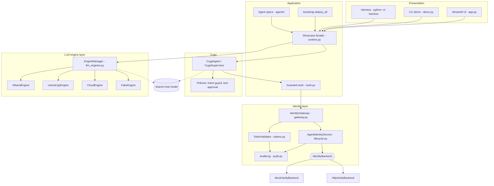

## Agent lifecycle (state machine)

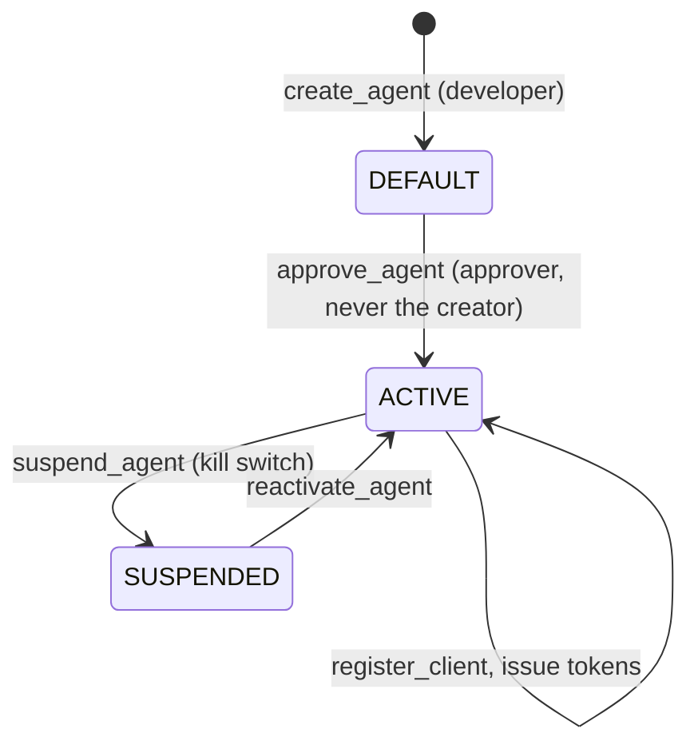

## Request path of one tool call

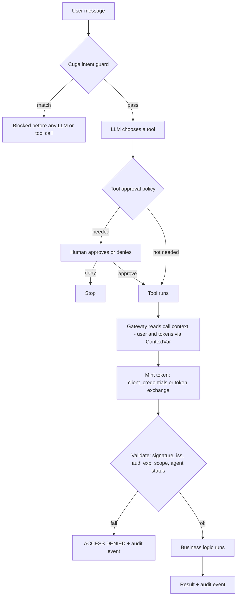

## LLM engine layer

`agent_identity/llm_engines.py` hides the model backend behind one interface. Agents never know which engine they use; they receive one shared LangChain chat model from `Showcase`.

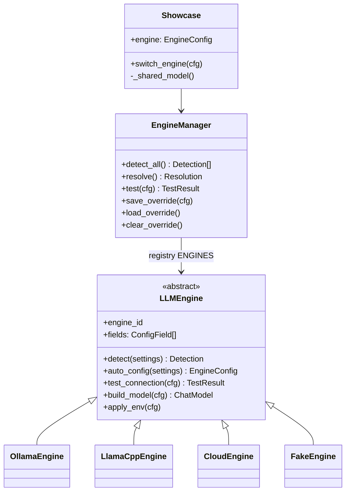

| Piece | Role |
|---|---|
| `EngineConfig` | Immutable description of the active engine: id, base URL, model, `SecretStr` key, source (`ui`, `env`, `auto`, `fallback`, `fake`). `public_dict()` never includes the key. |
| `ConfigField` | Declares the form fields of an engine, so the UI renders any engine without engine-specific code. |
| `Detection` | Result of probing: `running`, `installed`, `not detected`, endpoint, models. |
| `EngineManager` | Detection, resolution, connection tests and the persisted UI choice (`.cuga_state/llm_engine.json`, mode 600, no key). |
| `LLMEngineError` | Message plus remediation. Subclasses: `EngineMisconfigured`, `EngineUnavailable`, `EngineConnectionError`, `EngineSwitchError`. |

### Switching with a consistent state

`Showcase.switch_engine` (see the sequence diagram in the [README](../README.md#llm-engines)) is built around three objects: a `_ready` gate that makes new turns wait while a switch runs, an `_idle` event that is set when no turn is in flight, and a per-agent `MemorySaver` that outlives the model.

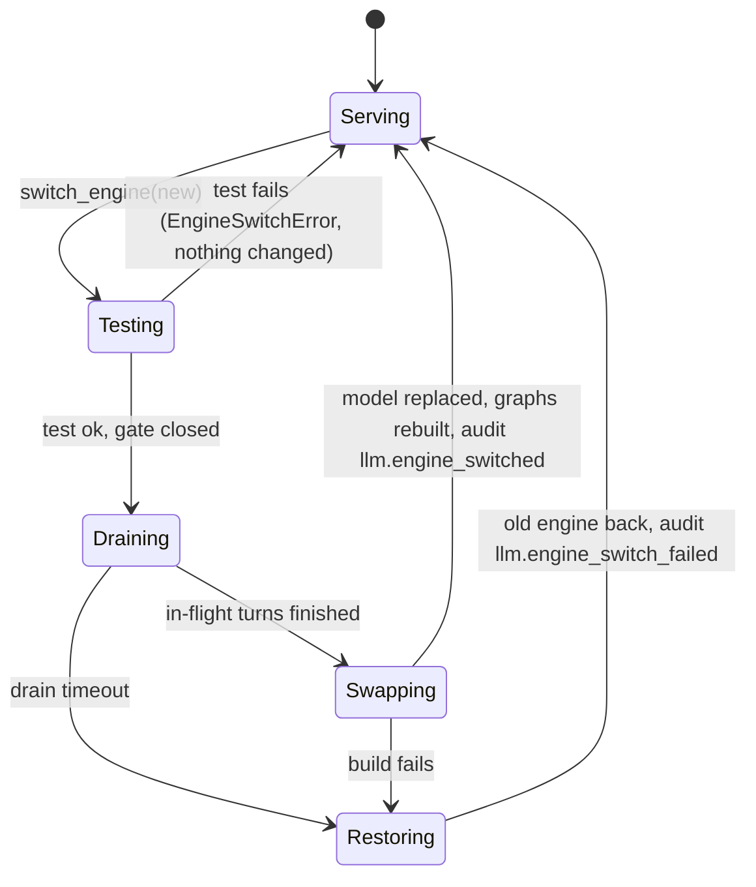

- A turn that started before the switch finishes on the old model. A turn that arrives during the switch waits at the gate and then runs on the new model.
- Cuga graphs are rebuilt lazily on the next turn by resetting `agent._graph` and `agent._compiled_graph`; this relies on Cuga 0.4.5 internals and should be re-checked when Cuga is upgraded.
- The checkpointer is ours, so chat history and pending approvals are not lost.
- Tokens, the agent registry and the audit log do not depend on the model at all.

### Error handling and logging

Every failure on the engine path becomes an `LLMEngineError` with a remediation. The UI prints both. The logger `agent_identity.llm` records the same text (never a key) and the audit log records switches. The fallback decisions made at start-up (`attempts` and `warnings` of `Resolution`) are logged and shown on the page when the app had to fall back.

## Design decisions

| Decision | Reason |
|---|---|
| Identity backend behind an interface | The showcase runs offline with a mock; a real tenant plugs in through `HttpVerifyBackend`. |
| Tokens are minted per tool call | Short lifetimes, narrow scopes, and the LLM never holds a credential. |
| User context travels in a `ContextVar` | Tools stay free of user-id parameters the LLM could forge. |
| Effective scope = user scopes intersected with agent ceiling | An agent can never exceed the user it acts for, nor its own approval. |
| Strict status check on every validation | Suspending an agent takes effect immediately, even for unexpired tokens. |
| One Cuga policy store per agent | Cuga's default store is shared per process; isolating it stops policies leaking between agents. |
| Audit events keyed by Agent ID | Management and runtime events can be read as one story. |
| One interface per LLM engine, data-driven form fields | A new engine is one class plus a registry entry; the UI needs no change. |
| Test the new engine before touching the old one | A bad URL or key can never leave the app without a working model. |
| UI choice never stores the API key | The key stays in `.env` or memory; the saved file can be read or shared without leaking it. |
| Plain http to a remote host is refused for the cloud engine | A key must not cross the network unencrypted. |

## Honest limits

- `HttpVerifyBackend` is a reference implementation and has not been run against a live IBM Verify tenant.
- The Harness Kit scaffolds skills; the conformance checks are the showcase's own (`harness/scenarios.py`).
- `execution_mode="codeact"` does not work with the default local model; `function_calling` is the default.
- The container image builds and starts (health check OK, `demo.py` runs inside it). Chatting with Ollama from inside the container was not exercised, and the image was built before the engine layer existed.
- LLM engines: Ollama detection, connection test, switching and persistence were exercised against a real local Ollama. **llama.cpp and cloud were tested with mocked HTTP only**: no `llama-server` was running and no cloud key was available.
- The runtime graph reset relies on private Cuga attributes (0.4.5).
- Small local models may not follow Cuga's tool protocol (`llama3.2:latest` hung in an earlier test); switching to them works but chat quality depends on the model.

## Identity flows

### 1. Onboarding (create, approve, register)

An agent gets a first-class identity before it can obtain a single token. Creation and activation are done by two different people (separation of duties).

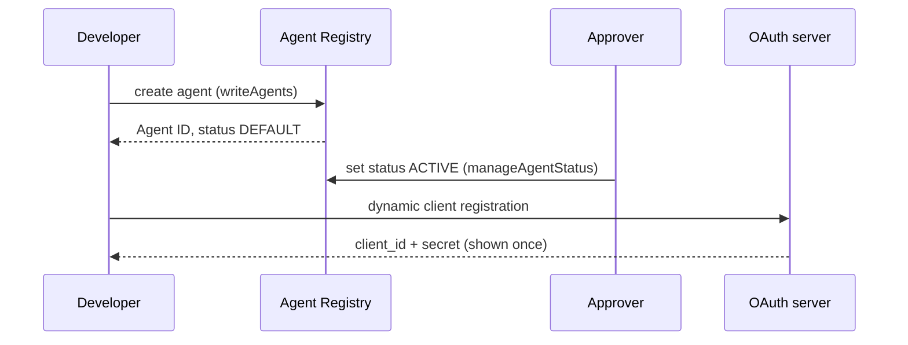

Key takeaways:

- The creator can never approve their own agent.
- Only ACTIVE agents can register a client or get tokens.
- Every step is audited under the same Agent ID.

### 2. Autonomous access (client credentials)

The agent acts as itself. The token carries an agent_id claim so the resource server knows exactly which agent called.

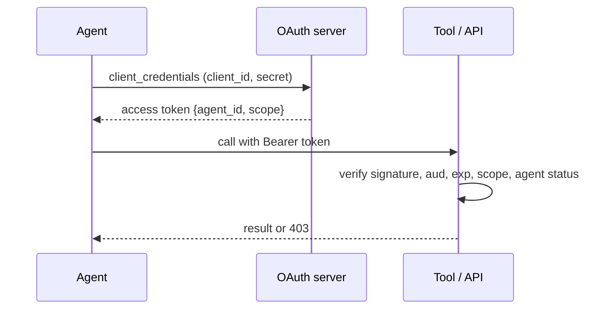

Key takeaways:

- Scopes are limited by the ceiling configured in the registry.
- Use for batch / back-office work with no human in the loop.

### 3. On-behalf-of (RFC 8693 token exchange)

The agent acts for a user. The exchanged token has sub=user and act.sub=agent, so the agent can never do more than the user is allowed to.

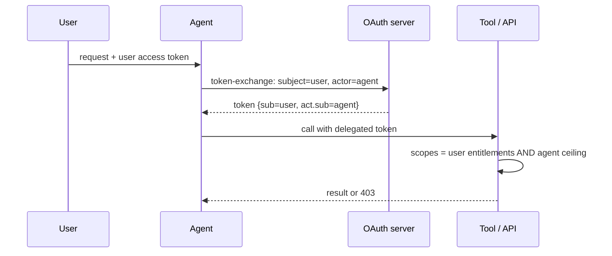

Key takeaways:

- Effective permission = user entitlements intersected with the agent ceiling.
- Carol cannot restart a service through the agent because Carol herself cannot.

### 4. Privileged action (human-in-the-loop)

Sensitive tools pause for approval (Cuga tool-approval policy) and then use a short-lived token with authorization_details scoped to one action.

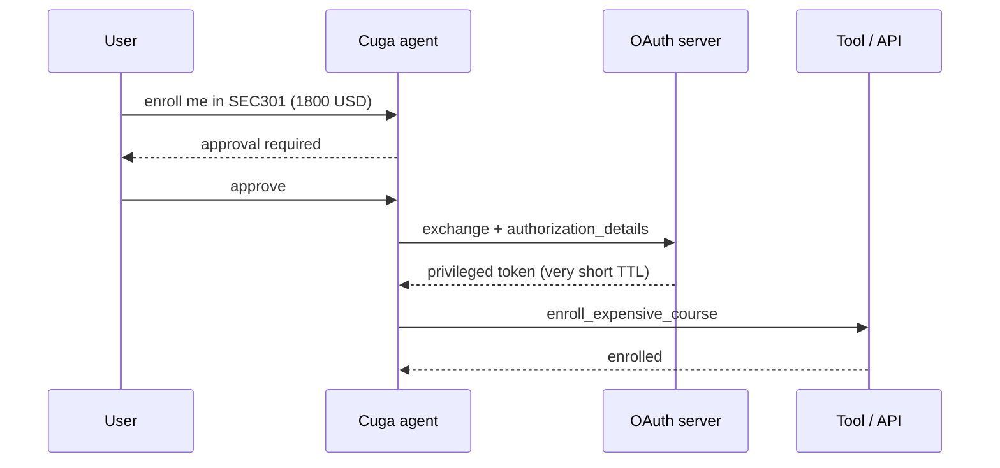

Key takeaways:

- Approval is enforced by the runtime policy, not by the prompt.
- The privileged token is bound to the specific action and expires quickly.

### 5. Multi-agent delegation (transaction context)

A supervisor delegates to a worker. The worker token nests the chain act(worker) -> act(supervisor), giving a complete audit trail.

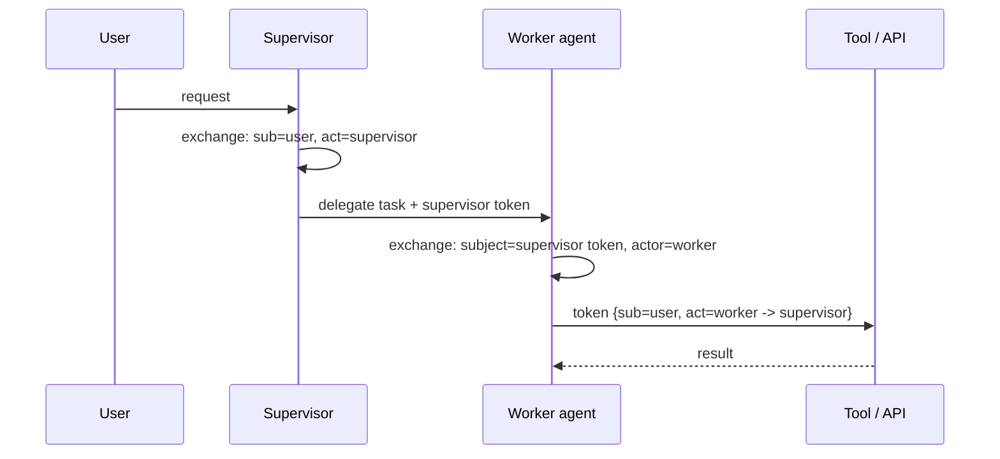

Key takeaways:

- The resource server sees who asked, and through which agents.
- Audit event 'access.granted' records the whole chain.

### 6. Kill switch (suspend)

Suspending an agent stops it from obtaining NEW tokens. Already-issued tokens stay valid until they expire, so resource servers should also check the agent status.

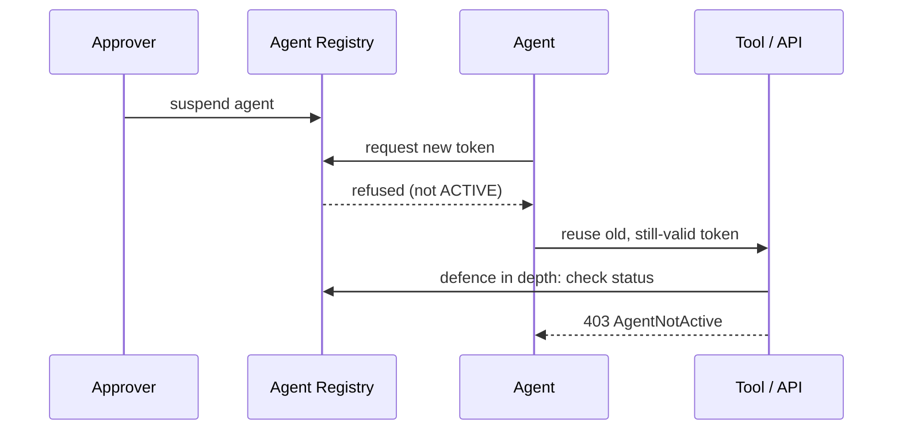

Key takeaways:

- Keep token TTLs short.
- This showcase enables the strict status check by default (AI_STRICT_STATUS_CHECK).
