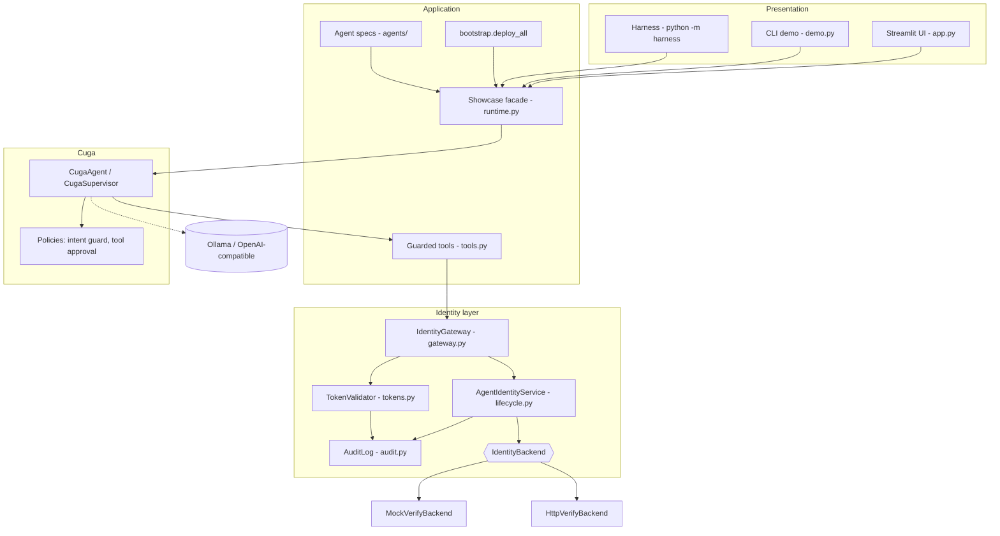
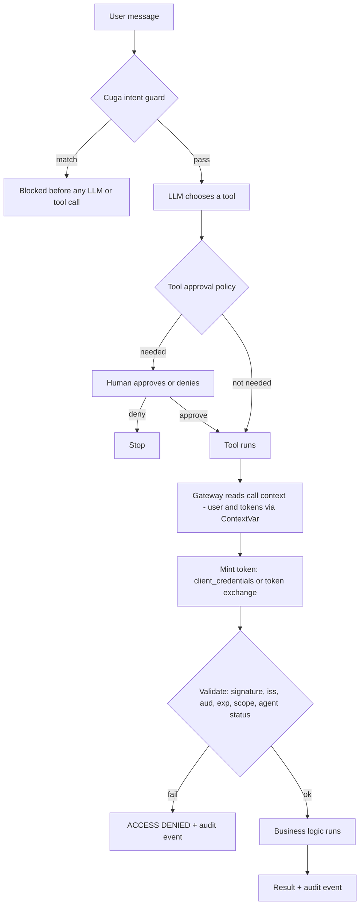
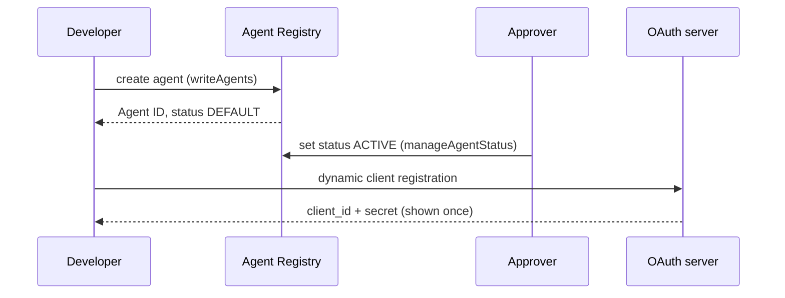
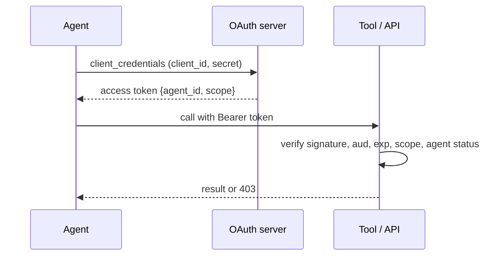
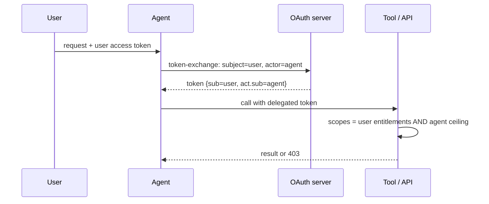
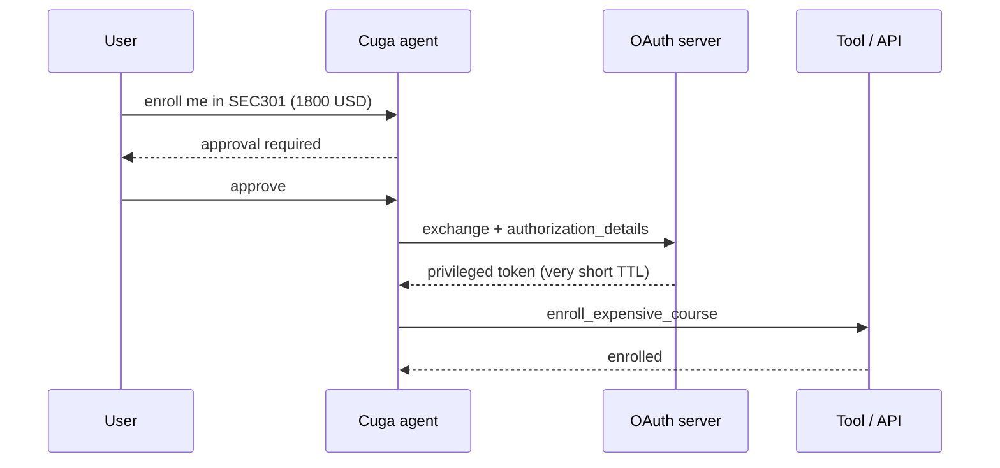
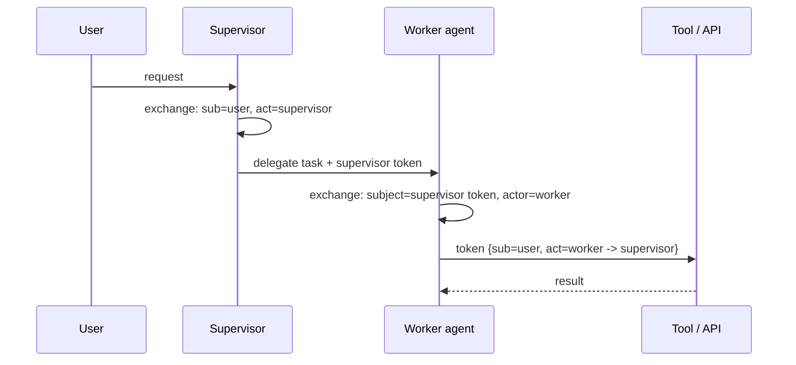
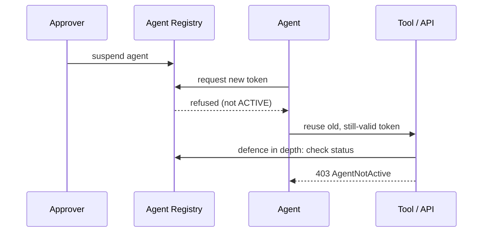

# Architecture

This page describes the components of the showcase and the six identity flows. The sequence diagrams below are generated from the same `FLOWS` data (`agent_identity/ui_helpers.py`) that powers the "How Agent Identity works" page in the UI, so the two stay consistent.

## Component view



## Agent lifecycle (state machine)

```mermaid
stateDiagram-v2
    [*] --> DEFAULT: create_agent (developer)
    DEFAULT --> ACTIVE: approve_agent (approver, never the creator)
    ACTIVE --> ACTIVE: register_client, issue tokens
    ACTIVE --> SUSPENDED: suspend_agent (kill switch)
    SUSPENDED --> ACTIVE: reactivate_agent
```

## Request path of one tool call



## Design decisions

| Decision | Reason |
|---|---|
| Identity backend behind an interface | The showcase runs offline with a mock; a real tenant plugs in through `HttpVerifyBackend`. |
| Tokens are minted per tool call | Short lifetimes, narrow scopes, and the LLM never holds a credential. |
| User context travels in a `ContextVar` | Tools stay free of user-id parameters the LLM could forge. |
| Effective scope = user scopes intersected with agent ceiling | An agent can never exceed the user it acts for, nor its own approval. |
| Strict status check on every validation | Suspending an agent takes effect immediately, even for unexpired tokens. |
| One Cuga policy store per agent | Cuga's default store is shared per process; isolating it stops policies leaking between agents. |
| Audit events keyed by Agent ID | Management and runtime events can be read as one story. |

## Honest limits

- `HttpVerifyBackend` is a reference implementation and has not been run against a live IBM Verify tenant.
- The Harness Kit scaffolds skills; the conformance checks are the showcase's own (`harness/scenarios.py`).
- `execution_mode="codeact"` does not work with the default local model; `function_calling` is the default.
- The Containerfile has not been built or tested in this repository's validation run.

## Identity flows

### 1. Onboarding (create, approve, register)

An agent gets a first-class identity before it can obtain a single token. Creation and activation are done by two different people (separation of duties).



Key takeaways:

- The creator can never approve their own agent.
- Only ACTIVE agents can register a client or get tokens.
- Every step is audited under the same Agent ID.

### 2. Autonomous access (client credentials)

The agent acts as itself. The token carries an agent_id claim so the resource server knows exactly which agent called.



Key takeaways:

- Scopes are limited by the ceiling configured in the registry.
- Use for batch / back-office work with no human in the loop.

### 3. On-behalf-of (RFC 8693 token exchange)

The agent acts for a user. The exchanged token has sub=user and act.sub=agent, so the agent can never do more than the user is allowed to.



Key takeaways:

- Effective permission = user entitlements intersected with the agent ceiling.
- Carol cannot restart a service through the agent because Carol herself cannot.

### 4. Privileged action (human-in-the-loop)

Sensitive tools pause for approval (Cuga tool-approval policy) and then use a short-lived token with authorization_details scoped to one action.



Key takeaways:

- Approval is enforced by the runtime policy, not by the prompt.
- The privileged token is bound to the specific action and expires quickly.

### 5. Multi-agent delegation (transaction context)

A supervisor delegates to a worker. The worker token nests the chain act(worker) -> act(supervisor), giving a complete audit trail.



Key takeaways:

- The resource server sees who asked, and through which agents.
- Audit event 'access.granted' records the whole chain.

### 6. Kill switch (suspend)

Suspending an agent stops it from obtaining NEW tokens. Already-issued tokens stay valid until they expire, so resource servers should also check the agent status.



Key takeaways:

- Keep token TTLs short.
- This showcase enables the strict status check by default (AI_STRICT_STATUS_CHECK).
