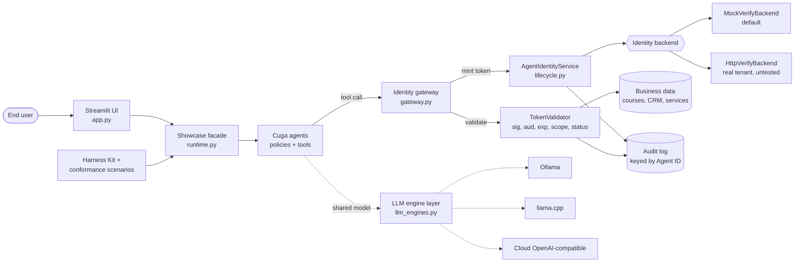
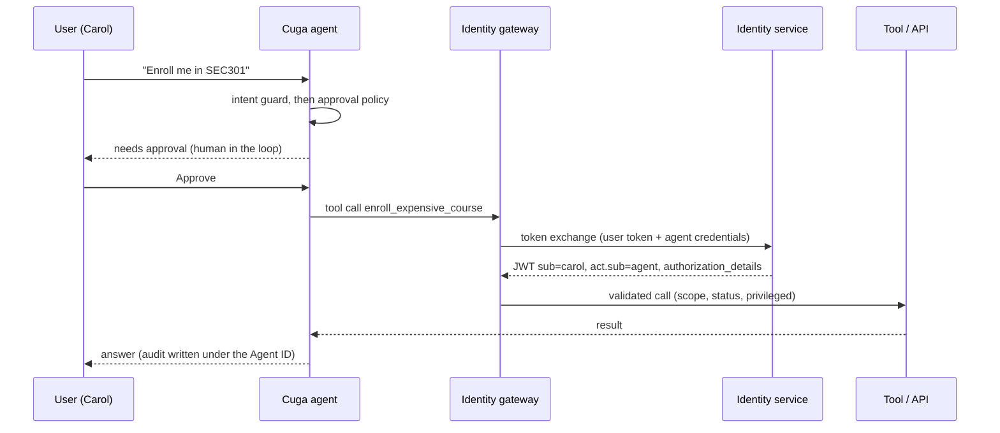
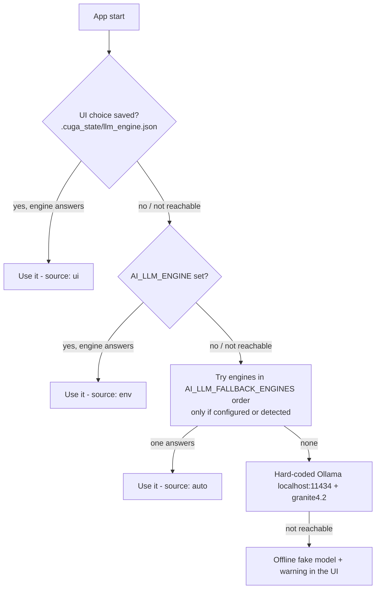
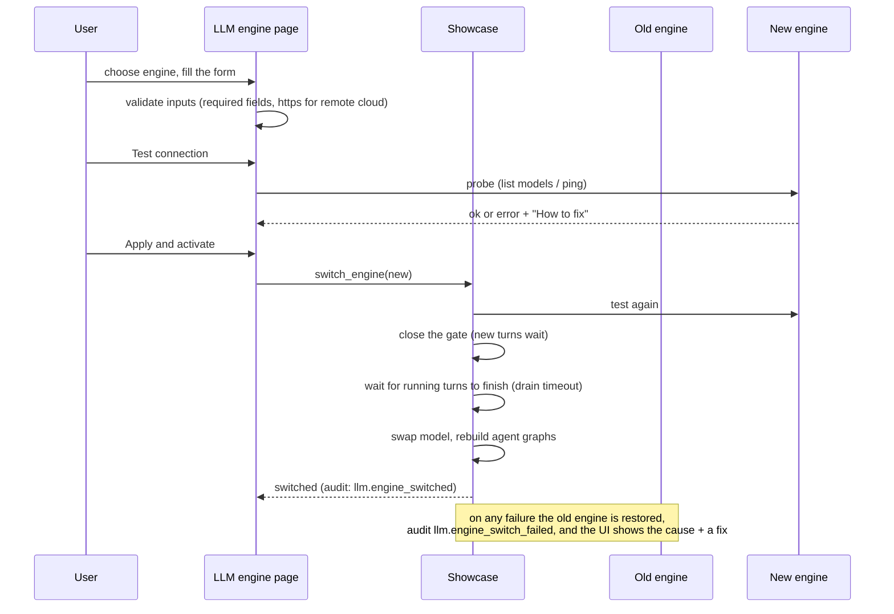

# Cuga + Agent Identity showcase

A runnable reference implementation that shows how to give AI agents a **real, governed identity** and how to build, deploy, test and operate them with the open-source **Cuga** agent stack.

| Piece | What it is | Link |
|---|---|---|
| Cuga Project | GitHub organisation behind the Cuga agent ecosystem | <https://github.com/cuga-project> |
| Cuga Agent | The agent framework used to run every example agent (`cuga==0.4.5`) | <https://github.com/cuga-project/cuga-agent> |
| Cuga Harness Kit | Scaffolds agent-building skills for coding assistants (`cuga-harness-kit==0.2.0`) | <https://github.com/cuga-project/cuga-harness-kit> |
| IBM Agent Identity | Product page for the identity model this showcase implements | <https://www.ibm.com/products/agent-identity> |

**License:** Apache-2.0 (see [`LICENSE`](LICENSE)).

## Read this first: what is real and what is simulated

- **Cuga Agent** is used for real: agent construction, tool execution, intent-guard and tool-approval policies, human-in-the-loop resume, supervisor delegation.
- **Agent Identity** has no public SDK. The showcase therefore ships a **local mock of the IBM Verify identity service** (`MockVerifyBackend`: RS256-signed JWTs, agent registry, dynamic client registration, client-credentials and RFC 8693 token exchange). `HttpVerifyBackend` is a reference implementation of the same interface for a real tenant. It has **not been tested against a live tenant**; treat it as a starting point.
- **Cuga Harness Kit** is not a test runner. It scaffolds skills for coding assistants (11 skills, installed with `init --targets bob`). The showcase runs it into a temporary folder to prove it works, and uses its own `harness/scenarios.py` (10 conformance scenarios) for validation.
- The LLM engine is **selectable**: local **Ollama** (default, `granite4.2:latest`), **llama.cpp** (`llama-server`) or a **cloud** OpenAI-compatible API. Pick it in the UI or in `.env` (see [LLM engines](#llm-engines)). Tests and the offline demo use a deterministic fake model, so no LLM is needed to run them.
- Live status of the engines: **Ollama** detection, test and switching were exercised against a real local daemon. **llama.cpp** and **cloud** were tested with mocked HTTP only (no `llama-server` and no cloud key were available), so treat them as unverified against a real server.

## Features

1. **Agent lifecycle**: create, approve (a *different* person), register an OAuth client, deploy, suspend (kill switch), reactivate.
2. **Four agents** covering different identity patterns:
   - **Learning Coach**: delegated (on-behalf-of) user actions, with human approval and a privileged token for expensive enrolments.
   - **Revenue Analyst**: autonomous agent with a read-only scope ceiling.
   - **Ops SRE Assistant**: privileged actions (service restart) bound to a short-lived token.
   - **Workplace Supervisor**: multi-agent orchestration with a nested actor chain in the token.
3. **Defence in depth**: Cuga policies (before the LLM), then per-tool identity checks (after the LLM). The LLM never sees a token.
4. **Interactive documentation**: six identity flows rendered as sequence diagrams, a token inspector, an audit trail keyed by Agent ID.
5. **Pluggable LLM engines**: Ollama, llama.cpp and cloud behind one interface, with detection, a settings page with *Test connection*, runtime switching without a restart, a documented fallback order and error messages that say how to fix the problem.
6. **Validation**: 118 unit tests, 10 harness conformance scenarios, a CLI demo and a UI smoke test.
7. **Operations**: structured logging, typed configuration, scripts for start/stop/cleanup, a multi-stage Containerfile.

## Architecture



Full diagrams: [`Docs/Architecture.md`](Docs/Architecture.md).

## Workflow of one delegated request



## LLM engines

The agents share one chat model. Which backend provides it is chosen at start-up and can be changed at any time from the UI.

| Engine | Id | What it talks to | Needs |
|---|---|---|---|
| Ollama (local) | `ollama` | `AI_OLLAMA_BASE_URL` (default `http://localhost:11434`) | a running daemon and `ollama pull <model>` |
| llama.cpp | `llamacpp` | `llama-server` OpenAI-compatible API (`AI_LLAMACPP_BASE_URL`, or probed from `AI_LLAMACPP_PROBE_URLS`) | `llama-server -m model.gguf --jinja --port 8080` (`--jinja` is needed for tool calling) |
| Cloud | `cloud` | any OpenAI-compatible hosted API | `AI_CLOUD_BASE_URL`, `AI_CLOUD_MODEL` and `AI_CLOUD_API_KEY`; `https://` for remote hosts |
| Fake | `fake` | nothing (offline, deterministic) | used by tests, the harness and `demo.py` |

**Which engine is used** (first match wins):



**Switching at runtime** (UI: *LLM engine* page; code: `Showcase.switch_engine`):



State that survives a switch: conversations and pending approvals (per-agent `MemorySaver`), agent registry, tokens and the audit trail.

**Using the UI** (`scripts/start.sh`, then *LLM engine* in the sidebar):

1. *Detected engines* lists what was found (status, endpoint, models). *Re-scan* refreshes it.
2. Pick an engine. The form shows its fields (URL, model, and for cloud a password field for the key).
3. *Test connection* checks reachability, authentication and that the model exists. Errors come with a *How to fix* line.
4. *Apply and activate* tests again, waits for running requests, then switches. If anything fails the previous engine stays active.
5. *Remember this choice* saves engine, URL and model to `.cuga_state/llm_engine.json` (mode 600). **The API key is never saved**; set `AI_CLOUD_API_KEY` in `.env` or type it again after a restart.
6. *Reset to .env defaults* removes the saved choice and re-resolves from `.env`.

**Configuration** (all in `.env`; see `.env.example`):

| Variable | Default | Meaning |
|---|---|---|
| `AI_LLM_ENGINE` | empty (auto) | `ollama`, `llamacpp`, `cloud` or `fake`; empty/`auto` = use the fallback order |
| `AI_LLM_FALLBACK_ENGINES` | `ollama,llamacpp,cloud` | order tried when nothing is chosen explicitly |
| `AI_LLM_TIMEOUT` | `300` | seconds one model call may take |
| `AI_LLM_MODE` | `ollama` | `fake` forces the offline model |
| `AI_OLLAMA_BASE_URL`, `AI_OLLAMA_MODEL` | `http://localhost:11434`, `granite4.2:latest` | Ollama settings |
| `AI_LLAMACPP_BASE_URL`, `AI_LLAMACPP_MODEL` | empty | llama.cpp server; empty URL = probe |
| `AI_LLAMACPP_PROBE_URLS` | `http://localhost:8080,http://localhost:9931` | URLs probed to detect llama-server (this machine's notes mention both ports) |
| `AI_LLAMACPP_BINARY` | empty | optional path to `llama-server`, shown as "installed" |
| `AI_CLOUD_BASE_URL`, `AI_CLOUD_MODEL`, `AI_CLOUD_API_KEY` | empty | a cloud engine is only auto-selected when all three are set |
| `OPENAI_BASE_URL`, `MODEL_NAME` | Ollama `/v1`, `granite4.2:latest` | legacy; still honoured as Ollama defaults |

Errors raised by the engine layer (`LLMEngineError`) carry a message and a remediation. They are shown in the UI and logged as `agent_identity.llm` lines, never with keys. More in [`Docs/Quickstart.md`](Docs/Quickstart.md#llm-engines) and [`Docs/Architecture.md`](Docs/Architecture.md#llm-engine-layer).

## Quick start

Prerequisites: Python 3.12, [`uv`](https://docs.astral.sh/uv/), optionally [Ollama](https://ollama.com) with `granite4.2:latest`.

```bash
scripts/setup.sh          # creates .venv with uv and installs requirements
cp .env.example .env      # optional: adjust settings
scripts/start.sh          # starts the UI detached and prints http://localhost:8601
scripts/stop.sh           # graceful shutdown
```

Other commands:

```bash
scripts/test.sh                      # unit tests (118)
.venv/bin/python -m harness          # Harness Kit + 10 conformance scenarios
.venv/bin/python demo.py             # offline CLI walk-through, writes output/demo_<timestamp>.md
.venv/bin/python demo.py --live      # also chats with agents through Cuga + Ollama
scripts/container.sh                 # build and run with Podman (CPU-only image, about 2.3 GB)
scripts/cleanup.sh                   # remove .venv, node_modules, __pycache__
scripts/remove_images.sh             # remove locally built container images
```

More: [`Docs/Quickstart.md`](Docs/Quickstart.md).

## Project layout

```
app.py                    Streamlit UI (9 pages, incl. LLM engine)
demo.py                   CLI demo
agent_identity/           identity layer: config, backend, tokens, lifecycle, gateway, tools, runtime, llm_engines, ui_helpers
agents/                   example agents (learning_coach, revenue_analyst, ops_sre_assistant)
harness/                  Harness Kit integration + conformance scenarios
tests/                    pytest suite (offline, fake LLM)
scripts/                  start, stop, setup, test, cleanup, container helpers
Docs/                     Quickstart, Architecture, concepts, best practices, interactive showcase page (HTML)
input/  output/           input folder and timestamped results (contents are git-ignored)
```

## Documentation

- [`Docs/AgentIdentity-Showcase.html`](Docs/AgentIdentity-Showcase.html): one interactive page for technical and non-technical readers. Introduction, architecture, agent lifecycle, LLM engine layer, validation results. Works offline (Mermaid is bundled in `Docs/assets/`); screenshots load from `.bob/artifacts/`. Open it with `open Docs/AgentIdentity-Showcase.html`.
- [`Docs/Quickstart.md`](Docs/Quickstart.md): run it, try it, clean it up.
- [`Docs/Architecture.md`](Docs/Architecture.md): components and all six identity flows as Mermaid diagrams.
- [`Docs/AgentIdentity-Concepts.md`](Docs/AgentIdentity-Concepts.md): the identity model explained.
- [`Docs/BestPractices.md`](Docs/BestPractices.md): code patterns to copy.

## Security notes

- No secrets are in the code. Copy `.env.example` to `.env` (git-ignored) for local settings.
- API keys are held as `SecretStr`, are never logged or shown, and are never written by the UI. A remote cloud engine over plain `http://` is refused.
- Tokens are short-lived (default 300 s); privileged tokens are narrower still.
- The token inspector decodes tokens for display only; tools always verify signature, issuer, audience, expiry, scope and agent status.
- The mock identity service is for demonstration. Do not use its keys or users in production.

## License

Apache-2.0. See [`LICENSE`](LICENSE).
