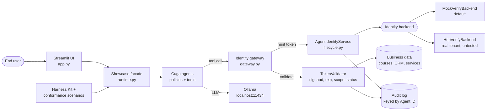
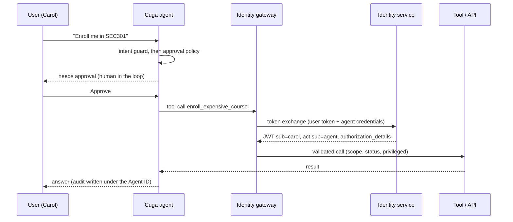

# Cuga + Agent Identity showcase

A runnable reference implementation that shows how to give AI agents a **real, governed identity** and how to build, deploy, test and operate them with the open-source **Cuga** agent stack.

| Piece | What it is | Link |
|---|---|---|
| Cuga Project | GitHub organisation behind the Cuga agent ecosystem | <https://github.com/cuga-project> |
| Cuga Agent | The agent framework used to run every example agent (`cuga==0.4.5`) | <https://github.com/cuga-project/cuga-agent> |
| Cuga Harness Kit | Scaffolds agent-building skills for coding assistants (`cuga-harness-kit==0.2.0`) | <https://github.com/cuga-project/cuga-harness-kit> |
| IBM Agent Identity | Product page for the identity model this showcase implements | <https://www.ibm.com/products/agent-identity> |

**License:** Apache-2.0 (see [`LICENSE`](LICENSE)).

## Read this first: what is real and what is simulated

- **Cuga Agent** is used for real: agent construction, tool execution, intent-guard and tool-approval policies, human-in-the-loop resume, supervisor delegation.
- **Agent Identity** has no public SDK. The showcase therefore ships a **local mock of the IBM Verify identity service** (`MockVerifyBackend`: RS256-signed JWTs, agent registry, dynamic client registration, client-credentials and RFC 8693 token exchange). `HttpVerifyBackend` is a reference implementation of the same interface for a real tenant. It has **not been tested against a live tenant**; treat it as a starting point.
- **Cuga Harness Kit** is not a test runner. It scaffolds skills for coding assistants (11 skills, installed with `init --targets bob`). The showcase runs it into a temporary folder to prove it works, and uses its own `harness/scenarios.py` (10 conformance scenarios) for validation.
- The default LLM is **local Ollama** (`granite4.2:latest`, `function_calling` mode). Tests and the offline demo use a deterministic fake model, so no LLM is needed to run them.

## Features

1. **Agent lifecycle**: create, approve (a *different* person), register an OAuth client, deploy, suspend (kill switch), reactivate.
2. **Four agents** covering different identity patterns:
   - **Learning Coach**: delegated (on-behalf-of) user actions, with human approval and a privileged token for expensive enrolments.
   - **Revenue Analyst**: autonomous agent with a read-only scope ceiling.
   - **Ops SRE Assistant**: privileged actions (service restart) bound to a short-lived token.
   - **Workplace Supervisor**: multi-agent orchestration with a nested actor chain in the token.
3. **Defence in depth**: Cuga policies (before the LLM), then per-tool identity checks (after the LLM). The LLM never sees a token.
4. **Interactive documentation**: six identity flows rendered as sequence diagrams, a token inspector, an audit trail keyed by Agent ID.
5. **Validation**: 80 unit tests, 10 harness conformance scenarios, a CLI demo and a UI smoke test.
6. **Operations**: structured logging, typed configuration, scripts for start/stop/cleanup, a multi-stage Containerfile.

## Architecture



Full diagrams: [`Docs/Architecture.md`](Docs/Architecture.md).

## Workflow of one delegated request



## Quick start

Prerequisites: Python 3.12, [`uv`](https://docs.astral.sh/uv/), optionally [Ollama](https://ollama.com) with `granite4.2:latest`.

```bash
scripts/setup.sh          # creates .venv with uv and installs requirements
cp .env.example .env      # optional: adjust settings
scripts/start.sh          # starts the UI detached and prints http://localhost:8601
scripts/stop.sh           # graceful shutdown
```

Other commands:

```bash
scripts/test.sh                      # unit tests (80)
.venv/bin/python -m harness          # Harness Kit + 10 conformance scenarios
.venv/bin/python demo.py             # offline CLI walk-through, writes output/demo_<timestamp>.md
.venv/bin/python demo.py --live      # also chats with agents through Cuga + Ollama
scripts/container.sh                 # build and run with Podman (not yet built or tested)
scripts/cleanup.sh                   # remove .venv, node_modules, __pycache__
scripts/remove_images.sh             # remove locally built container images
```

More: [`Docs/Quickstart.md`](Docs/Quickstart.md).

## Project layout

```
app.py                    Streamlit UI (8 pages)
demo.py                   CLI demo
agent_identity/           identity layer: config, backend, tokens, lifecycle, gateway, tools, runtime, ui_helpers
agents/                   example agents (learning_coach, revenue_analyst, ops_sre_assistant)
harness/                  Harness Kit integration + conformance scenarios
tests/                    pytest suite (offline, fake LLM)
scripts/                  start, stop, setup, test, cleanup, container helpers
Docs/                     Quickstart, Architecture, concepts, best practices
input/  output/           input folder and timestamped results (contents are git-ignored)
```

## Documentation

- [`Docs/Quickstart.md`](Docs/Quickstart.md): run it, try it, clean it up.
- [`Docs/Architecture.md`](Docs/Architecture.md): components and all six identity flows as Mermaid diagrams.
- [`Docs/AgentIdentity-Concepts.md`](Docs/AgentIdentity-Concepts.md): the identity model explained.
- [`Docs/BestPractices.md`](Docs/BestPractices.md): code patterns to copy.

## Security notes

- No secrets are in the code. Copy `.env.example` to `.env` (git-ignored) for local settings.
- Tokens are short-lived (default 300 s); privileged tokens are narrower still.
- The token inspector decodes tokens for display only; tools always verify signature, issuer, audience, expiry, scope and agent status.
- The mock identity service is for demonstration. Do not use its keys or users in production.

## License

Apache-2.0. See [`LICENSE`](LICENSE).
